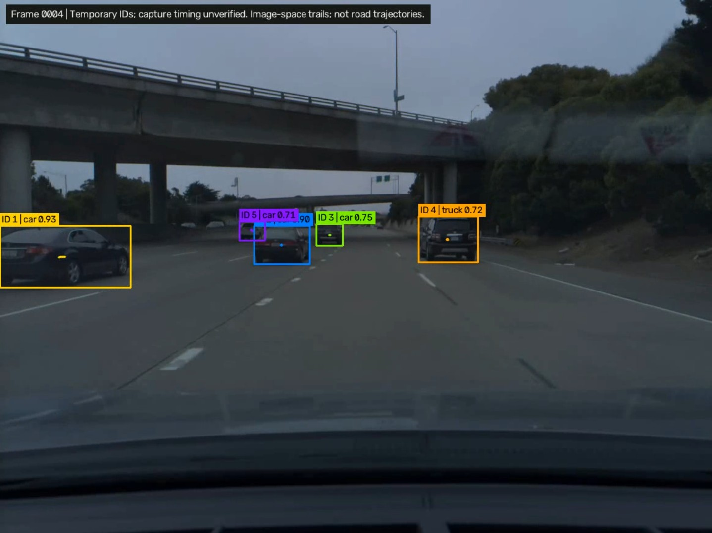
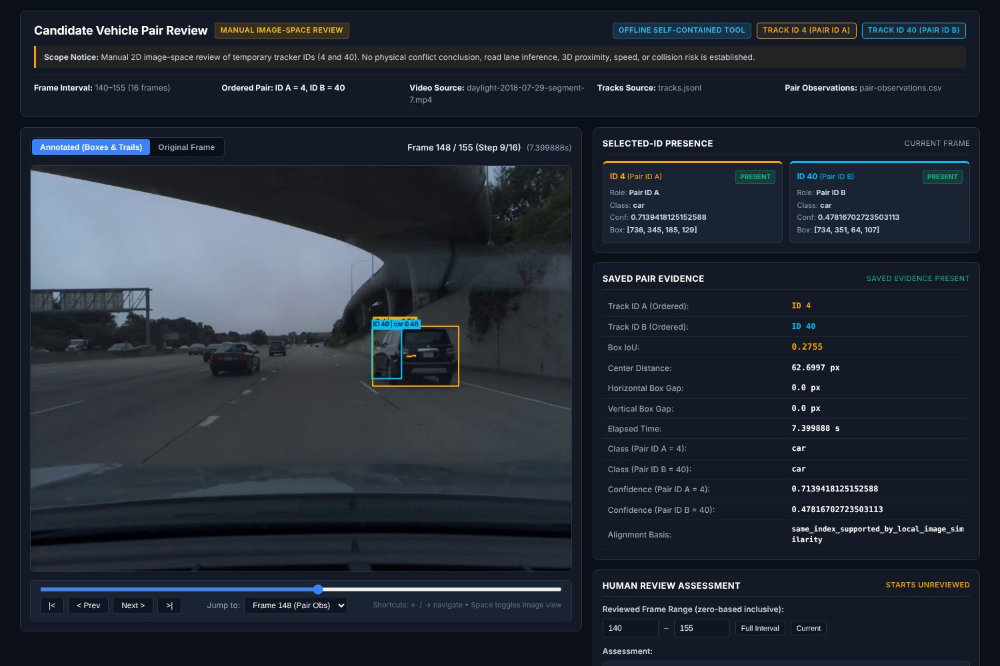

# Dashcam Vehicle Detection, Tracking & Manual Review (offline, CPU)

This repository contains an offline, modular Python pipeline for monocular vehicle detection, temporary frame-to-frame association tracking, image-space trajectory/pair relationship extraction, and self-contained human candidate review of ambiguous tracking cases.

> [!IMPORTANT]
> **Scope & Methodological Notice:**
> - All detections, bounding boxes, trajectories, and pair observations operate purely in **2D image space** (pixel coordinates on monocular dashboard video).
> - This repository **does not** claim or establish validated traffic conflict detection, tracking accuracy benchmarks (MOTA/HOTA), unique physical vehicle counts, 3D world proximity, roadway lane inference, vehicle speeds, Time-To-Collision (TTC), or collision/safety risk.





---

## Setup

- Requires **uv** and **Python 3.14**.
- Run `uv sync` to install dependencies.
- `data/` is not included in the repository.
- The video comes from the comma2k19 dataset via `scripts/download_daylight_sample.py`.
- The downloaded HEVC must then be converted to MP4 (for example with ffmpeg) at `data/preview/daylight-2018-07-29-segment-7.mp4`; the exact conversion command used here was not recorded.
- The model file `object_detection_yolox_2022nov.onnx` must be placed manually in `data/models/` from the OpenCV Zoo YOLOX page, expected SHA-256 (`c5c2d13e59ae883e6af3b45daea64af4833a4951c92d116ec270d9ddbe998063`).

---

## 1. Pipeline Architecture & Local Artifacts

The offline pipeline processes monocular video segments sequentially, saving intermediate auditable records at each stage without re-running upstream inference:

| Stage / Script | Input Artifacts | Output Artifacts | Description |
|---|---|---|---|
| **Pose & Timing Retrieval**<br>`scripts/fetch_daylight_pose.py` | Remote archive `Chunk_1.zip` (Range requests) | `data/raw/daylight-2018-07-29-segment-7-pose/`<br>• `frame_times`<br>• `frame_gps_times`<br>• `frame_positions`<br>• `frame_orientations`<br>• `frame_velocities`<br>• `manifest.json` | Retrieves and validates 5 extensionless ego-motion pose and timing NumPy arrays matching local HEVC video CRC32 `d6ab0260`. |
| **Decoded Frame Alignment**<br>`scripts/inspect_daylight_frame_alignment.py` | `data/raw/daylight-2018-07-29-segment-7.hevc`<br>`data/preview/daylight-2018-07-29-segment-7.mp4` | Terminal report / alignment audit | Compares decoded frames across candidate offsets $\{-2, -1, 0, +1, +2\}$; strongly supports same-index correspondence within the examined window (offset 0 uniquely lowest MAD across all 1,200 frames). Qualified `alignment_basis`; not confirmed exhaustive proof against all conversion alterations. |
| **Video Detection**<br>`scripts/detect_vehicle_video.py` | `data/preview/daylight-2018-07-29-segment-7.mp4`<br>`data/models/object_detection_yolox_2022nov.onnx` | `data/preview/daylight-detection-1200-v1/`<br>• `annotated.mp4`<br>• `detections.jsonl`<br>• `summary.json` | Runs OpenCV Zoo YOLOX-S with class-agnostic NMS across vehicle classes (`car`, `truck`, `bus`, `motorcycle`). Refuses overwrite. |
| **Offline IoU Tracking**<br>`scripts/track_vehicle_detections.py` | `data/preview/daylight-detection-1200-v1/detections.jsonl` | `data/preview/daylight-tracking-1200-v1/`<br>• `tracks.jsonl`<br>• `summary.json` | Frame-to-frame greedy bounding-box IoU matching (threshold 0.3, max 5 missed frames, cross-class matching). Assigns incrementing temporary IDs. |
| **Track Video Rendering**<br>`scripts/render_vehicle_tracks.py` | `data/preview/daylight-2018-07-29-segment-7.mp4`<br>`data/preview/daylight-tracking-1200-v1/tracks.jsonl` | `data/preview/daylight-tracking-1200-v1/`<br>• `tracked.mp4`<br>• `tracked-trails-20.mp4` | Renders color-coded bounding boxes, badges, caveat banners, and optional image-space trajectory trails (`--trail-length 20`). |
| **Trajectory CSV Export**<br>`scripts/export_vehicle_trajectories.py` | `data/preview/daylight-tracking-1200-v1/tracks.jsonl` | `data/preview/daylight-tracking-1200-v1/trajectories.csv` | Exports ordered 2D image-space trajectory records, validating positive dimensions and duplicate ID rejection. |
| **Timed Trajectory Export**<br>`scripts/attach_trajectory_timing.py` | `trajectories.csv`<br>`data/raw/daylight-2018-07-29-segment-7-pose/frame_times` | `data/preview/daylight-tracking-1200-v1/trajectories-timed.csv` | Attaches logger boot-relative time, elapsed source time, and qualified `alignment_basis` without modifying original tracks. |
| **Trajectory Coverage Summary**<br>`scripts/summarize_trajectory_coverage.py` | `data/preview/daylight-tracking-1200-v1/trajectories-timed.csv` | `data/preview/daylight-tracking-1200-v1/trajectory-coverage.csv` | Generates per-track observation summaries, frame/timestamp spans, within-track gap counts, and class transitions. |
| **Vehicle Pair Export**<br>`scripts/export_vehicle_pair_observations.py` | `data/preview/daylight-tracking-1200-v1/trajectories-timed.csv` | `data/preview/daylight-tracking-1200-v1/pair-observations.csv` | Exports same-frame 2D spatial relationships (`box_iou`, center distance, horizontal/vertical gaps) for frames with $\ge 2$ detections. |
| **Candidate Review Builder**<br>`scripts/build_candidate_review.py` | MP4 preview, `tracks.jsonl`, and `pair-observations.csv` | `data/preview/daylight-tracking-1200-v1/candidate-review-*.html` | Generates self-contained offline HTML review tools with embedded frames, display selectors, evidence tables, and review JSON export. |

---

## 2. Measured Full-Clip Results (1,200 Frames)

The full 60-second daylight segment (`b0c9d2329ad1606b|2018-07-29--11-17-20/7`, frames 0–1199) was processed through detection and tracking checkpoints:

- **Processed Frames:** 1,200 consecutive frames (1164 × 874 px).
- **Total Detections:** 3,324 vehicle detections across 1,200 frames (3,246 car, 75 truck, 3 bus).
- **Temporary Track IDs:** 146 temporary track IDs generated.
  - Temporary IDs represent tracking associations, **not verified unique physical vehicles**.
  - 75 IDs have $\le 2$ observations; only 6 tracks remained active at frame 1199.
  - Track length distribution: minimum 1 frame, median 2 frames, mean 22.77 frames, maximum 478 frames.
- **Hardware & Detection Loop Performance:**
  - Evaluated on a CPU laptop.
  - Detection raw inference: mean 124.85 ms, median 121.34 ms.
  - Detection processing loop duration: 173.13 seconds, approximately 6.9 frames/s on the CPU laptop (not real-time), covering video decoding, model inference, and output writing. This reflects the video detection processing loop, not throughput for the entire multi-stage pipeline.

---

## 3. Offline Candidate Vehicle Pair Review Tool

When bounding-box IoU is positive or tracking associations are ambiguous (e.g. dense clusters, occlusions, or potential duplicate detections), `scripts/build_candidate_review.py` creates a standalone, self-contained HTML file. The tool runs completely offline with embedded JPEG Base64 frames and vanilla JavaScript—requiring no server, backend, framework, CDN, or network access.

### Exact Command Using Existing Local Inputs

> [!WARNING]
> The builder script strictly checks destination paths and **refuses to overwrite existing files**. You must specify a new, non-existent file path for `--output`.

```bash
uv run --no-sync python scripts/build_candidate_review.py \
  --video data/preview/daylight-2018-07-29-segment-7.mp4 \
  --tracks data/preview/daylight-tracking-1200-v1/tracks.jsonl \
  --pairs data/preview/daylight-tracking-1200-v1/pair-observations.csv \
  --start-frame 140 \
  --end-frame 155 \
  --ids 4 40 \
  --output data/preview/daylight-tracking-1200-v1/candidate-review-4-40-manual.html
```

#### CLI Contract:
- `--video`: Path to unannotated input video MP4.
- `--tracks`: Path to `tracks.jsonl` containing tracking records.
- `--pairs`: Path to `pair-observations.csv` containing pair metrics.
- `--start-frame` / `--end-frame`: Zero-based inclusive frame bounds (maximum interval of 60 frames).
- `--ids`: Exactly two distinct positive temporary IDs (e.g. `--ids 4 40`).
- `--output`: New output HTML path (fails if file already exists).

### Interactive Viewer Controls

1. **Display Selector (`Both IDs` / `ID A only` / `ID B only`):**
   - **Both IDs** (default): Renders bounding boxes, label badges, and image-space trails for both candidate IDs.
   - **ID A only**: Renders the bounding box, label badge, and trail exclusively for ID A, removing ID B's annotations.
   - **ID B only**: Renders the bounding box, label badge, and trail exclusively for ID B, removing ID A's annotations.
   - Allows reviewers to clearly disentangle overlapping boxes, obscured label text, and intersecting trails.
   - Active buttons display the track's distinctive assigned color accent.

2. **Original Frame Toggle (`Annotated` vs. `Original Frame`):**
   - Instantly switches between annotated tracking overlays and raw, unannotated video frames to inspect underlying vehicle chassis, wheels, and road surface.
   - Selecting any ID display mode automatically activates the annotated view.

3. **Synchronized Navigation:**
   - Scrubber range slider, step buttons (`|<`, `< Prev`, `Next >`, `>|`), and "Jump to Frame" selector (highlighting frames with saved pair observations).
   - **Keyboard Shortcuts:** `←` / `→` step frames, `Space` toggles between Annotated and Original Frame, `1` selects Both IDs, `2` selects ID A only, `3` selects ID B only, `Home` / `End` jump to interval boundaries.

4. **Presence Indicators & Exact Saved Evidence:**
   - Live status badges indicate whether ID A and ID B are `PRESENT` or `ABSENT` in the active frame, showing bounding-box coordinates and confidence.
   - Displays exact saved pair observation values directly from `pair-observations.csv` without rounding or recalculation: `box_iou`, `center_distance_px`, `horizontal_box_gap_px`, `vertical_box_gap_px`, elapsed time, and `alignment_basis`.

---

## 4. Human Assessment & Review JSON Export

The review pane provides a structured assessment form to record human reviewer findings:

- **Reviewed Frame Range:** Defaults to the interval; reviewer can restrict to specific evaluated frames (e.g., frame 148).
- **Assessment Classifications (Human assessments scoped strictly to reviewed frames, not independently verified identities):**
  - `same_vehicle`: Human assessment of duplicate detector boxes on a single physical vehicle in the reviewed frame(s).
  - `distinct_vehicles`: Human assessment of separate physical vehicles in the reviewed frame(s).
  - `uncertain`: Visual occlusion, ambiguous association, or visual limits prevent determination in the reviewed frame(s).
- **Qualitative Notes:**
  - `uncertainty_notes`: Textarea documenting ambiguity, occlusions, visual limits, or reasons for uncertainty.
  - `supporting_observations`: Textarea documenting visual observations (e.g., box overlap on chassis, lane markings, motion continuity).

### JSON Export Behavior & Storage Notice

Clicking **"Download Review JSON"** validates form fields and triggers a client-side browser file download conforming to schema `candidate_review_v1`:

> [!CAUTION]
> **Manual Repository Save Required:**
> Clicking "Download Review JSON" triggers a download in the user's browser; **it does not automatically save into the repository working tree**. The reviewer must manually inspect and place the exported JSON into the workspace (e.g. inside `data/preview/daylight-tracking-1200-v1/`).

---

## 5. Completed Review Examples

Two representative ambiguous cases identified during pair-observation analysis have been reviewed and saved locally:

### Case 1: Duplicate Boxes on Single Vehicle (Frame 148, IDs 4 & 40)
- **Generated HTML:** `data/preview/daylight-tracking-1200-v1/candidate-review-4-40.html` (interval 140–155).
- **Saved Review JSON:** `docs/evaluation/reviews/candidate_review_ids_4_40_frames_148_148.json`.
- **Saved Metrics:** `box_iou = 0.2755`, center distance `62.6997 px`.
- **Human Assessment:** `same_vehicle` (scoped to frame 148 only).
- **Findings:** The original image at frame 148 shows a single dark SUV body traveling along the right roadway edge. Duplicate bounding boxes for IDs 4 and 40 appear on that same vehicle chassis, supporting a duplicate-box assessment at frame 148. This review establishes duplicate boxes at frame 148, not the creation time of the tracks.

### Case 2: Occluded Cluster with Uncertain Correspondence (Frame 375, IDs 44 & 57)
- **Generated HTML:**
  - Original review HTML: `data/preview/daylight-tracking-1200-v1/candidate-review-44-57.html` (covers interval 370–380).
  - Single-frame verification tool: `data/preview/daylight-tracking-1200-v1/candidate-review-44-57-selector-v1.html` (covers frame 375 only).
- **Saved Review JSON:** `docs/evaluation/reviews/candidate_review_ids_44_57_frames_375_375.json` (saved from the original 370–380 review tool before the selector increment; no revised assessment was exported afterward).
- **Saved Metrics:** `box_iou = 0.4045`, center distance `17.0074 px`.
- **Human Assessment:** `uncertain` (scoped to frame 375 only).
- **Findings:** Two vehicles (one yellow vehicle and one dark vehicle) are visible in an occluded cluster at frame 375. Bounding boxes overlap significantly and their label badges obscure each other. Visual ambiguity prevents confident 2D box-to-vehicle assignment. This represents visual tracking ambiguity, not a physical conflict.

---

## 6. Verification Limits & Methodological Caveats

- **No Automated Test Suite:** No automated regression or unit test suite has been run or established across the pipeline.
- **Selector Verification Scope:** The display selector (`Both IDs` / `ID A only` / `ID B only`) was verified in a single-frame check (`candidate-review-44-57-selector-v1.html` on frame 375). This check confirmed individual ID box/label separation, Original Frame toggle, and saved pair evidence display, but **did not verify trajectory trails across multi-frame motion or JSON export after the selector change**.
- **Not All Validation Guards Tested:** While `scripts/build_candidate_review.py` enforces frame bounds, interval limits, and matching track/pair IDs, not all negative guard paths have been exercised.
- **No Physical Conflict Interpretation:** High bounding-box IoU values in 2D image space frequently arise from perspective line-of-sight alignment (e.g. distinct vehicles behind the median overlapping in projection at frame 1095; their physical separation was not established), detector duplication, or visual occlusion. They do not constitute traffic conflicts, near-misses, or safety events.

---

## 7. Attribution & Licensing Status

- **Dataset Source:** Stated as [commaai/comma2k19](https://huggingface.co/datasets/commaai/comma2k19) on Hugging Face (GitHub repository: [commaai/comma2k19](https://github.com/commaai/comma2k19)), under publisher-stated **MIT License**.
- **Object Detection Model:** Stated as OpenCV Zoo YOLOX-S ONNX model weights and implementation ([OpenCV Zoo YOLOX](https://github.com/opencv/opencv_zoo/tree/main/models/object_detection_yolox) and [Megvii YOLOX](https://github.com/Megvii-BaseDetection/YOLOX)), under publisher-stated **Apache 2.0 License**.
- **Licensing Notice:** This repository does not redistribute the dataset video or the model weights. See NOTICE.md.
